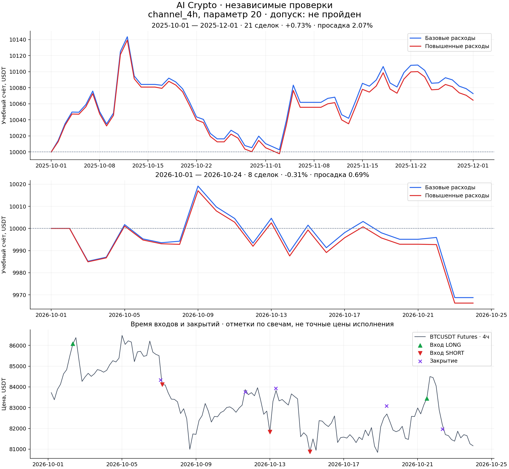

# AI Crypto — вторая серия исследований

**Решение: кандидат не прошёл критерии допуска. Прибыльная замена боту не подтверждена.**

Это воспроизводимый исторический эксперимент, а не результат реальной торговли. Работающий бот не изменён. Все проценты ниже относятся к учебному счёту 10 000 USDT без плеча.

## Что проверили

- BTCUSDT, ETHUSDT и SOLUSDT: минутные цены Binance USD-M Futures, опубликованные ставки финансирования и минутные mark prices.
- Шесть заранее заданных вариантов: пробой 20/55 четырёхчасовых свечей; пересечение EMA 12/48 или 24/96; часовой пробой 20/40 свечей после сжатия.
- Начальный стоп — 3 ATR; затем он подтягивается за закрытыми свечами. Фиксированной цели нет; максимальное удержание — семь дней.
- Решение только после закрытия свечи; вход через одну полную минуту после границы. Изменённый стоп действует со следующей минуты.
- Комиссия 0,055% с каждой стороны плюс неблагоприятное исполнение 0,045% с каждой стороны. Финансирование учтено отдельно по истории. В стресс-сценарии исполнение ухудшено до 0,09% с каждой стороны, комиссия прежняя.
- Плановый риск до 0,25% счёта на сделку; ограничения общего риска, суммы позиций и одинакового направления. Начало новых сделок останавливается при дневном снижении 2% или общей просадке 8%; это не гарантия предельного убытка.

## Разделение истории

Разработка: январь–июнь 2025. Выбор: июль–сентябрь 2025. После фиксации кандидата — две отдельные проверки: октябрь–ноябрь 2025 и 1–23 октября 2026. Каждая проверка начинает с 10 000 USDT без открытых позиций. Период 24–30 октября 2026 исключён: он уже проверялся для предыдущего бота. Январь–сентябрь 2026 также не используется как новая проверка. В датах JSON правая граница не включается. Декабрь 2024 используется для прогрева индикаторов.

## Все варианты до финальной проверки

| Вариант | Разработка: результат | Выбор: результат | Сделки при выборе | Прибыль / убытки |
|---|---:|---:|---:|---:|
| Пробой диапазона, 4 часа · 20 | +0.04% | +1.68% | 34 | 2.19 |
| Пробой диапазона, 4 часа · 55 | +0.34% | +1.31% | 23 | 1.95 |
| Пересечение средних, 4 часа · 12 | -1.22% | +1.70% | 19 | 2.74 |
| Пересечение средних, 4 часа · 24 | +0.13% | +1.38% | 11 | 14.50 |
| Выход из сжатия, 1 час · 20 | -2.86% | +2.68% | 93 | 1.34 |
| Выход из сжатия, 1 час · 40 | -3.77% | +0.42% | 73 | 1.06 |

Зафиксированный кандидат: **Пробой диапазона, 4 часа · 20**. Прошёл предварительный отбор: **да**.

## Результаты после фиксации

| Проверка | Сделки | Изменение счёта | Прибыльных сделок | Прибыль / убытки | Макс. просадка |
|---|---:|---:|---:|---:|---:|
| Октябрь–ноябрь 2025 | 21 | +0.73% | 42.9% | 1.58 | 2.07% |
| Октябрь–ноябрь 2025, повышенные расходы | 21 | +0.65% | 42.9% | 1.51 | 2.07% |
| 1–23 октября 2026 | 8 | -0.31% | 37.5% | 0.47 | 0.69% |
| 1–23 октября 2026, повышенные расходы | 8 | -0.34% | 37.5% | 0.44 | 0.69% |

«Прибыль / убытки» — сумма чистых выигрышей, делённая на абсолютную сумму чистых проигрышей. Значение меньше 1 означает убыток. Просадка учитывает открытые позиции и рассчитана по минутам; на графике показаны только дневные точки.

## Устойчивость параметров и допуск

- Соседний параметр 18: +1.34% на периоде выбора, 38 сделок.
- Соседний параметр 22: +1.62% на периоде выбора, 32 сделок.

- Предварительный отбор: положительный результат и не менее 20 сделок: **да**.
- Не менее 50 сделок суммарно в двух финальных периодах: **нет**.
- Оба соседних параметра положительны: **да**.
- Оба финальных периода положительны, прибыль/убытки ≥1,15 и просадка <8%: **нет**.
- Оба периода остаются положительными при повышенных расходах: **нет**.

## Графики



Отметки входов и выходов на ценовом графике показывают время событий по ценам минутных свечей; они не изображают точные цены исполнения с проскальзыванием. Полный журнал событий включён в results.json.

## Ограничения

Проверены три выбранных крупных актива, а не вся биржа. Повторный поиск среди стратегий повышает риск случайно найти красивую историю. Два периода проверки не доказывают устойчивость во всех режимах рынка, особенно короткое окно октября 2026. Проверка соседних параметров выполнена на периоде выбора; новые параметры не выбирались по финальным результатам. Настоящие исторические bid/ask, очередь исполнения и точная цена расчёта финансирования неизвестны: использованы фиксированные расходы и открытие минутной mark-свечи. Внутриминутный порядок событий приблизителен; при неоднозначности применяется стоп первым. Конечный результат не является обещанием доходности и не подтверждает 80% прибыльных сделок.

Исследования AQR [Time Series Momentum](https://www.aqr.com/insights/research/journal-article/time-series-momentum) и [Which Trend Is Your Friend?](https://www.aqr.com/insights/research/journal-article/which-trend-is-your-friend) послужили мотивацией проверить трендовые правила. Их результаты на других активах и горизонтах не доказывают прибыльность этих криптостратегий.

## Воспроизведение

Из корня репозитория, с установленными numpy, pandas и matplotlib:

```bash
python -m unittest discover -s research -p "test_*.py"
python research/search_round2.py --cache /tmp/ai_crypto_futures --output research/round2
python research/plot_round2.py
python research/report_round2.py
```

SHA256 исходных архивов записаны в manifest.json; загрузчик сравнивает их с опубликованными CHECKSUM. Пропущенный день mark prices за 29 июня 2026 дополнен официальными дневными архивами. Проверки движка охватывают расходы, финансирование, баланс, порядок стопов, отсутствие использования будущих свечей и структуру периодов.
